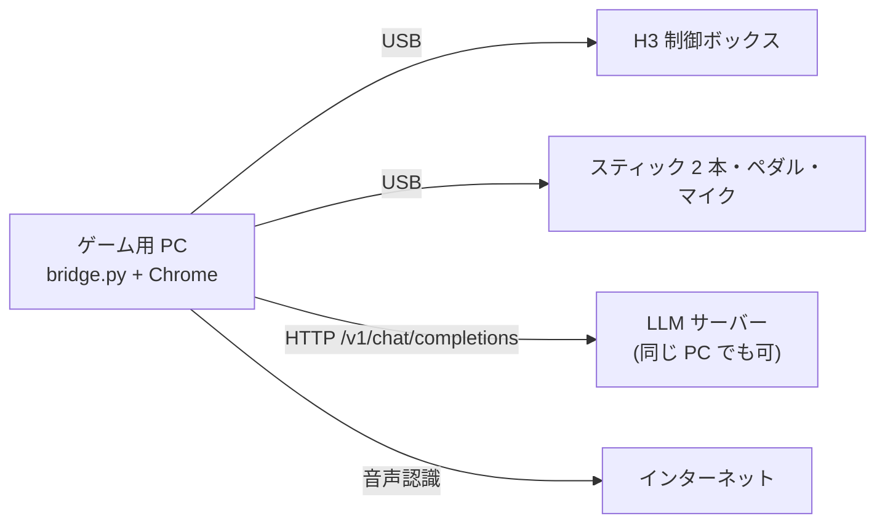

# インストール手順 ― 別の PC + 手元の LLM サーバーで動かす

最初にやること: ターミナルで `git clone <このリポジトリ>` を実行し、`cd <リポジトリ>/h3game` に入る。

全体は 5 ステップ。LLM サーバーがすでにあるなら 20 分。無いなら、モデルのダウンロードぶん(+10〜30 分)が足される。



## 手元にあるか確認(1 分)

- [ ] Mac または Windows の PC。**Google Chrome** が入っていて、インターネットにつながる
- [ ] DOF Reality H3(制御ボックスと USB ケーブル、電源)
- [ ] USB マイク(「USB PnP Audio Device」なら自動で選ばれる。無ければ内蔵マイクでも動く)
- [ ] スティック・ペダル(無くてもキーボードで動く)
- [ ] LLM サーバー(無くても「AI なし」で動く。ステップ 3 で作れる)

## ステップ 1 / 5: `uv` を入れる(3 分)

Mac:

```sh
curl -LsSf https://astral.sh/uv/install.sh | sh
```

Windows(PowerShell):

```powershell
powershell -ExecutionPolicy ByPass -c "irm https://astral.sh/uv/install.ps1 | iex"
```

完了の目印: 新しいターミナルで `uv --version` が数字を返す。
Python と部品(pyserial, pygame)は、ステップ 4 の起動時に `uv` が自動で用意する。

`uv` を使いたくない場合だけ: Python 3.10〜3.12 で `python3 -m pip install --user pyserial pygame`(3.14 は pygame が入らないことがある)。

## ステップ 2 / 5: H3 と機器をつなぐ(2 分)

1. H3 の制御ボックスを USB でつなぎ、電源を入れる。
2. スティック・ペダル・マイクを USB でつなぐ。
3. Mac だけ: 「システム設定 > サウンド > 入力」で USB マイクを選ぶ。

完了の目印(Mac): `ls /dev/cu.*` に `usbmodem…` が 1 つ出る。
2 つ以上出るなら、H3 以外の USB シリアル機器を抜く(起動スクリプトは最初に見つかった方を使う)。

## ステップ 3 / 5: LLM サーバーを用意する(5 分 + ダウンロード)

すでに OpenAI 互換の `/v1/chat/completions` があるなら、URL をメモしてステップ 4 へ。

無ければ **Ollama** が一番早い。LLM サーバーにする PC で:

```sh
ollama pull qwen2.5:3b
OLLAMA_HOST=0.0.0.0 ollama serve
```

URL は `http://<その PC の IP>:11434/v1/chat/completions`。ゲーム用 PC と同じ PC なら `http://localhost:11434/v1/chat/completions`。

完了の目印: ゲーム用 PC から次を実行して JSON が返る。

```sh
curl -s http://<IP>:11434/v1/chat/completions -H 'Content-Type: application/json' \
  -d '{"model":"qwen2.5:3b","messages":[{"role":"user","content":"{\"ok\": true} とだけ返して"}]}'
```

llama.cpp server(ハッカソンで使った構成)にしたい場合: `llama-server -m qwen2.5-3b-instruct-q4_k_m.gguf --host 0.0.0.0 --port 8080 -ngl 99`。URL は `http://<IP>:8080/v1/chat/completions`。モデル名の指定は不要。

## ステップ 4 / 5: 起動する(1 分)

`h3game/` で、ステップ 3 の URL を入れて実行する。

Mac(Ollama のとき):

```sh
H3_LLM_URL=http://<IP>:11434/v1/chat/completions H3_LLM_MODEL=qwen2.5:3b ./start.command
```

Mac(llama.cpp のとき): `H3_LLM_MODEL` を外す。

Windows:

```bat
set H3_LLM_URL=http://<IP>:11434/v1/chat/completions
set H3_LLM_MODEL=qwen2.5:3b
start.bat
```

完了の目印: 黒い画面に `H3 接続: /dev/cu.usbmodem…`(Windows は `COM3` など)と `画面: http://localhost:8891` が出る。

`H3 未接続(空回りモード)` と出たら、USB と電源を確認する。つなぎ直せば数秒で自動でつながる(起動し直しは不要)。

毎回打つのが面倒なら、`start.command` の `exec uv run` の行の前に `export H3_LLM_URL=...` を書き足す。

## ステップ 5 / 5: ブラウザで確認する(5 分)

1. Chrome で http://localhost:8891 を開く(ブリッジを動かしている PC で開く。他の PC から開くと「見るだけ」)。
2. マイクの許可を求められたら「許可」。
3. 確認画面の上の帯が「席 OK。入力 3/3 OK。」になるのを見る。スティックは、ボタンを 1 回押すか大きく倒すと出る。
4. 「左右に揺らす」を押して席の向きを見る。逆なら「向きを逆にする」にチェック。
5. 「スタート」を押し、シーン 1 で「おはよう」と叫ぶ。判定後に **「AI 判定」** と出れば LLM までつながっている。

完了の目印: HP と MP が表示され、チャイムのあとシーン 2(教室)が始まる。

最初は揺れの大きさ 0.35 のまま、人を乗せずにシーン 2 の地震まで通す。

## 困ったとき

症状から探す。上から順に多い。

| 症状 | 直し方 |
|---|---|
| 「AI なし」と出る | ブリッジの黒い画面に `LLM エラー:` が出ている。`H3_LLM_URL` の IP とポート、Ollama なら `H3_LLM_MODEL` を確認。ステップ 3 の `curl` をもう一度 |
| 「音声認識が使えません」 | Chrome 以外のブラウザか、インターネット未接続。代用: キーボードの `1`〜`5` |
| 言葉を言っているのに札が埋まらない | 画面下に出る認識結果を見る。`web/scene2_quake.js` の `ITEMS` の正規表現に、その文字を足す |
| `H3 未接続` のまま | USB ケーブル、制御ボックスの電源。`ls /dev/cu.*` に別の `usbmodem` があれば抜く |
| スティックが出ない | 画面を一度クリックしてからボタンを押す。黒い画面に `joy_reader エラー` が出ていないか見る |

上に無い症状:

| 症状 | 直し方 |
|---|---|
| 席が逆に動く | 確認画面の「向きを逆にする」 |
| 音量がすぐ 100 になる / 上がらない | `web/mic.js` の `DB_MIN` / `DB_MAX`(既定 −42 / −8 dB)を動かす |
| 揺れが強すぎる | 確認画面の「揺れの大きさ」を下げる |
| 席に触れずに画面だけ試したい | `H3_DRY=1 ./start.command` |

次にやること: ステップ 1 の `uv --version` を打つ。
