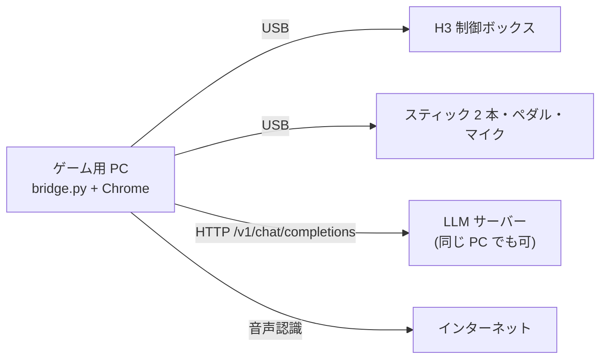

# インストール手順 ― 別の PC と手元の LLM サーバーで動かす

所要時間の目安: 30 分(LLM のモデルのダウンロードを除く)。



## 用意するもの

| もの | 備考 |
|---|---|
| PC(Mac または Windows) | **Google Chrome** が必要(音声認識のため)。インターネットにつながっていること |
| DOF Reality H3 | 制御ボックスを USB でつなぎ、電源を入れる |
| スティック・ペダル | Thrustmaster T.16000M ×2、Saitek Pro Flight Rudder Pedals で動作確認済み。無くてもキーボードで動く |
| USB マイク | 「USB PnP Audio Device」があれば自動で選ぶ。無ければ内蔵マイク |
| LLM サーバー | OpenAI 互換の `/v1/chat/completions` を出せるもの。無くても「AI なし」で動く(下の「3. LLM サーバー」) |
| Python 3.12 | `uv` があれば自動で用意される |

## 1. ファイルを置く

このリポジトリの `h3game/` フォルダごとコピーする。他のフォルダは不要。

```sh
git clone <このリポジトリ>
cd <リポジトリ>/h3game
```

## 2. Python と部品

`uv` を入れておくと、起動スクリプトが Python 3.12 と部品(pyserial, pygame)を自動で用意する。

```sh
# Mac
curl -LsSf https://astral.sh/uv/install.sh | sh
# Windows(PowerShell)
powershell -ExecutionPolicy ByPass -c "irm https://astral.sh/uv/install.ps1 | iex"
```

`uv` を使わない場合は Python 3.10〜3.12 に手で入れる(3.14 では pygame が入らないことがある)。

```sh
python3 -m pip install --user pyserial pygame
```

## 3. LLM サーバー

ブリッジは `H3_LLM_URL` に OpenAI 互換の JSON を POST する。音声は送らず文字だけなので、3B 程度の小さいモデルで足りる。
応答に 2〜3 秒以上かかると判定の待ち時間が目立つので、GPU があるとよい。

### (a) llama.cpp server(ハッカソンで使った構成)

```sh
# Qwen2.5-3B-Instruct の GGUF を用意して
llama-server -m qwen2.5-3b-instruct-q4_k_m.gguf --host 0.0.0.0 --port 8080 -ngl 99
```

エンドポイントは `http://<サーバーの IP>:8080/v1/chat/completions`。モデル名の指定は不要。

### (b) Ollama

```sh
ollama pull qwen2.5:3b
ollama serve          # 既定で 11434 番
```

別 PC から使うなら、サーバー側で `OLLAMA_HOST=0.0.0.0 ollama serve`。
エンドポイントは `http://<サーバーの IP>:11434/v1/chat/completions`、**モデル名が必要**なので `H3_LLM_MODEL=qwen2.5:3b` を付ける。

### (c) 同じ PC で動かす

Mac なら Ollama を同じ PC に入れて `H3_LLM_URL=http://localhost:11434/v1/chat/completions` でよい。

### 動作確認

```sh
curl -s http://<IP>:<port>/v1/chat/completions -H 'Content-Type: application/json' \
  -d '{"model":"qwen2.5:3b","messages":[{"role":"user","content":"{\"ok\": true} とだけ返して"}],"response_format":{"type":"json_object"}}'
```

JSON が返れば OK(`model` は llama.cpp では無視される)。

## 4. 起動

```sh
cd h3game
# LLM の場所を指定して起動(Mac)
H3_LLM_URL=http://192.168.1.20:8080/v1/chat/completions ./start.command
# Ollama のとき
H3_LLM_URL=http://192.168.1.20:11434/v1/chat/completions H3_LLM_MODEL=qwen2.5:3b ./start.command
```

Windows はコマンドプロンプトで:

```bat
set H3_LLM_URL=http://192.168.1.20:8080/v1/chat/completions
start.bat
```

黒い画面に `H3 接続: /dev/cu.usbmodem…`(Windows は `COM3` など)と出れば席につながっている。
`H3 未接続(空回りモード)` のときは、USB と電源を確認する。つなぎ直せば数秒で自動でつながる。

席に触れずに画面だけ試すなら `H3_DRY=1 ./start.command`。

毎回打つのが面倒なら、`start.command` の `exec uv run ...` の行の前に `export H3_LLM_URL=...` を書き足す。

## 5. ブラウザ側の設定

1. **Chrome** で http://localhost:8891 を開く(ブリッジを動かしている PC で。他の PC から開くと「見るだけ」になる)。
2. マイクの許可を求められたら「許可」。
3. **Mac の「システム設定 > サウンド > 入力」で USB マイクを選ぶ。** 音声認識はここで選ばれたマイクを使う(ゲーム側の音量測定は USB PnP を自動で選ぶが、音声認識は選べない)。
4. 確認画面で次を見る。
   - 席: 「● H3 接続中」
   - スティック1・2・ペダル: ボタンを 1 回押すか大きく倒すと出る。挿すだけで自動で割り当たる
   - マイク: 「あー」と言って棒が動く
5. 「左右に揺らす」などで席の向きを確かめる。逆なら「向きを逆にする」にチェック。
6. 揺れの大きさは 0.35 のまま、まず空の席でシーン 2 の地震まで試す。

## 6. 通し確認

| 確認 | 期待する動き |
|---|---|
| シーン 1 で両レバーを引く | ゲージが溜まり、席がのけぞる |
| 「おはよう」と叫ぶ | 判定後に HP/MP が出て、「AI 判定」と表示される(「AI なし」なら LLM に届いていない) |
| シーン 2 で 5 つ答える | 札が緑になる。画面下に認識した文字が出る |
| シーン 3 でぶつかる | HP が減り、席が突き上げる |
| 玄関で「ただいま」 | 「おかえり！」 |

## 困ったとき

| 症状 | 見るところ |
|---|---|
| `H3 未接続` のまま | USB ケーブル、制御ボックスの電源。Mac は `ls /dev/cu.*` に `usbmodem` があるか。別の USB シリアル機器が先に見つかると誤認するので外す(`h3_direct.py` の `find_port` は最初の候補を使う) |
| 席が逆に動く | 確認画面の「向きを逆にする」 |
| スティックが出ない | 画面を一度クリックしてからボタンを押す。ブリッジの黒い画面に `joy_reader エラー` が出ていないか |
| 音声認識が動かない(「音声認識が使えません」) | Chrome か、インターネットにつながっているか。Safari/Firefox は非対応。キーボードの `1`〜`5` で代用できる |
| 認識はするが言葉が通らない | 回答中に画面下へ出る認識結果を見て、`scene2_quake.js` の `ITEMS` の正規表現に足す |
| 「AI なし」になる | ブリッジの黒い画面に `LLM エラー:` が出る。URL、ポート、サーバー側のファイアウォール、Ollama なら `H3_LLM_MODEL` |
| 音量がすぐ 100 に張り付く / 上がらない | `web/mic.js` の `DB_MIN` / `DB_MAX`(既定 −42 / −8 dB)を動かす |
| 揺れが強すぎる | 確認画面の「揺れの大きさ」を下げる。シーン 2 だけなら `scene2_quake.js` の `want` の値 |
| 画面からの信号が止まった | 席は 1 秒ほどで中央に戻る。ブリッジが落ちていれば起動し直す |
